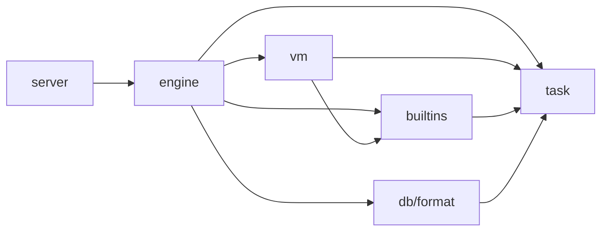

# Execution ownership

The engine owns executable tasks. The interpreter and builtins operate on their
shared language state. A saved interpreter is a concrete `*vm.VM` held by
`engine.Task`; it is not stored in the lower task package.

## Packages and objects

| Owner | Responsibility | Implementation |
| --- | --- | --- |
| `task.Context` | Current activation permissions, transaction view, budgets and deferred effects | [context.go](../task/context.go#L17) |
| `task.State` | Task identity, lifecycle, activations, suspension, readiness and task-local values | [task.go](../task/task.go#L60) |
| `engine.Task` | Inline state, saved interpreter and catalog membership | [task.go](../engine/task.go#L12) |
| `engine.Runtime` | Execution leases, admission, transactions, retry, continuation handoff and finalization | [runtime.go](../engine/runtime.go), [task_runtime.go](../engine/task_runtime.go) |
| Engine catalog and scheduler | Registered tasks, unfinished index, ready queues, batching and workers | [task_manager.go](../engine/task_manager.go), [scheduler.go](../engine/scheduler.go) |
| `vm.VM` | Bytecode, operand stack, frames and instruction execution | [vm.go](../vm/vm.go#L21) |
| `builtins.Registry` and `builtins.Session` | Dispatch definitions; mutable builtin resources and host capabilities | [registry.go](../builtins/registry.go), [session.go](../builtins/session.go#L7) |
| `builtins.Execution` | One interpreter's reused builtin-call context and interpreter services | [registry.go](../builtins/registry.go#L17), [op_misc.go](../vm/op_misc.go#L13) |

The central import direction is:

The diagram omits shared value, compiler, store and utility dependencies.
`task` imports neither `engine`, `vm`, nor `builtins`. The former `kernel`
context now belongs to `task`.

## Lifetime and synchronization

`engine.Task` embeds `task.State` by value. Its constructor initializes that
storage in place, then binds settlement notification to the containing task.
VMs and builtins receive `&owner.State`. They do not need a reverse lookup from
task ID to interpreter, including for direct server hooks that are not cataloged.
Fork construction installs the child's interpreter before queue registration.
See [task.go](../engine/task.go#L18), [call_verb.go](../engine/call_verb.go#L251)
and [task_factory.go](../engine/task_factory.go#L285).

State and saved-interpreter publication share `State.Mu`. `Task.VM` and `SetVM`
are leaf lock operations. Catalog registration takes the catalog lock, then
`State.Mu`, then the unfinished-index lock. State transitions notify that index
without acquiring the catalog or runtime lock. `Unfinished` only copies the
index under its own lock. See [task.go](../engine/task.go#L38) and
[task_manager.go](../engine/task_manager.go#L61).

Logical suspension or completion can precede physical execution handoff.
The runtime's execution lease therefore remains separate from task status.
GC walks require the runtime's existing quiescence conditions in addition to
a synchronized saved-pointer read. See [runtime.go](../engine/runtime.go#L238)
and [runtime.go](../engine/runtime.go#L653).

Checkpoint capture holds `State.Mu` across metadata copying and the concrete VM
snapshot. Persisted records stay in `task` so format readers and writers do not
depend on the execution engine. The runtime separately establishes when frame
capture is safe. In-memory retry retains its existing VM checkpoint rather than
serializing to these disk records. See [task.go](../engine/task.go#L60),
[snapshot.go](../task/snapshot.go#L176), and [retry.go](../vm/retry.go).

## Calls across the boundary

Builtin host task finders expose `*task.State`; engine catalog methods expose
`*engine.Task`. Suspension duration handling belongs to State, while selecting
and scheduling another task remains with the engine. The scheduler's readier
map compares the inline State addresses, preserving object identity.

Nested synchronous VMs share the parent's state and transaction context but
have their own interpreter frames. Their profiling parent is the narrow
`mooprof.Parent` sampling contract. It supplies live frames and adjusts ancestor
tick/time baselines; it does not execute or own interpreters. The VM binds it
once when creating its cached `builtins.Execution`.
See [mooprof.go](../internal/mooprof/mooprof.go#L41),
[profile.go](../vm/profile.go), and [op_misc.go](../vm/op_misc.go#L13).

## Evidence

The task record is [refactor-execution-layering.md](../agent-notes/refactor-execution-layering.md).
It distinguishes source changes, CI results and measured workloads. Moving
ownership alone does not establish a speedup. Allocation and timing comparisons
must be read with their recorded source revisions and workload limitations.
